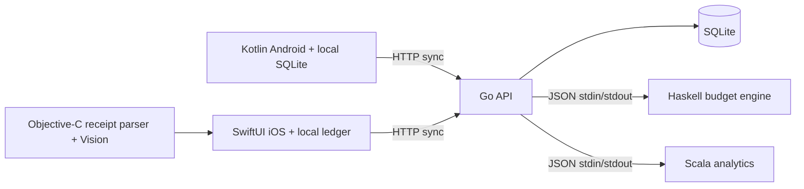

# PocketLedger

A native mobile expense tracker with an offline queue, exact-cent budget calculations, and a small polyglot backend. Built as an AI-assisted personal learning project by Bhavesh Mantrabuddi.

**Validation:** Go tests/vet, both actual calculation workers, 43 worker-protocol cases, 26 live HTTP integration assertions, 18 Android JVM tests and 5 Android device tests passed locally. The Android debug APK builds. **Swift/Objective-C and iOS Simulator execution remain pending macOS validation.** See the [validation record](docs/VALIDATION.md) for evidence and limitations.

## What it does

- Add and review USD expenses even when the API is offline.
- Persist pending creates, deletes, and budget changes across restarts.
- Synchronize with stable client IDs, safe replay, and explicit partial-failure handling.
- View category spending, daily trends, and an explicitly labeled pace estimate.
- Export the selected month's expenses as CSV through the native file/share interface, with spreadsheet-formula escaping.
- On iOS, recognize a receipt on-device, then review its suggested merchant, date, and total before saving.

## Six languages with separate responsibilities

| Language | Component | Responsibility |
|---|---|---|
| Go | `server/` | Validated HTTP API, SQLite persistence, synchronization, bounded worker subprocesses |
| Haskell | `workers/haskell/` | Exact-integer budget summary and calendar-aware pace calculations |
| Scala | `workers/scala/` | Deterministic category totals, zero-filled daily series, largest expenses |
| Kotlin | `android/` | Native Android app and persistent offline operation queue |
| Swift | `ios/` | Native SwiftUI app, local ledger, typed API client, sync state machine |
| Objective-C | `ios/PocketLedgerKit/Sources/ReceiptKit/` | Receipt parsing and Apple Vision OCR, imported by Swift |

The extra worker languages are intentional learning boundaries. A smaller real-world app could consolidate them. Each worker is invoked by the actual API, rather than serving as a disconnected language sample.



See [CONTRACT.md](CONTRACT.md) for the wire protocol, validation rules, money conventions, and offline behavior. All example records are synthetic.

## Run the backend

Prerequisites: Go 1.26+, Java 17, GHC 9.6.7 with Cabal, Scala CLI, and Python 3.10+. Dependencies and build-tool versions are pinned in the component files. No paid service or API key is required. SQLite is embedded; no database server is needed.

On Windows, from the repository root:

```powershell
./workers/build.ps1
python scripts/verify.py
./scripts/start.ps1
```

On macOS/Linux:

```sh
cabal update
sh workers/build.sh
python3 scripts/verify.py
cd server
go run ./cmd/pocketledger
```

`python scripts/verify.py --build` combines the worker build/tests and real integration verification. It creates an isolated temporary synthetic ledger, exercises actual executable/JAR workers, checks HTTP replay/conflict behavior and calendar calculations, and restarts the API to verify persistence. It does not touch the development ledger.

The API defaults to `http://127.0.0.1:8080`. Start from the repository or a child directory so the executable can locate `CONTRACT.md` and `.local/workers/`. Native clients save expenses offline even when the API or calculation workers are unavailable.

## Android

Open `android/` in Android Studio with JDK 17 and SDK platform 35, or use the [component build instructions](android/README.md). The Gradle wrapper verifies its distribution checksum. A successful `assembleDebug` produces `android/app/build/outputs/apk/debug/app-debug.apk`.

Android Emulator reaches the host API at `http://10.0.2.2:8080`. Add expenses, change the budget, inspect month totals, explicitly sync, and export CSV. The first-time server configuration preserves unsent data. Once a server has acknowledged changes, switching servers is blocked until pending changes are sent; an allowed switch clears the old synced cache.

## iOS / Objective-C

The [native Apple client](ios/README.md) contains a SwiftUI app, actor-isolated local journal, typed API client, CSV file exporter, and Objective-C receipt parser/Vision wrapper. A Mac is needed to compile the Apple-framework targets, either locally or through a hosted macOS runner. **No Apple build or test pass is currently claimed.**

The manually triggered **Apple validation** workflow is provided for future execution. No hosted workflows have been run for this delivery. A simulator build is separate from signing and installing on a physical iPhone.

## Test commands

```sh
cd server && go test ./... && go vet ./...
```

```sh
python scripts/verify.py --build
```

```sh
cd android
./gradlew testDebugUnitTest assembleDebug assembleDebugAndroidTest
./gradlew connectedDebugAndroidTest
```

Windows uses `gradlew.bat`. Instrumentation tests require a running emulator/device. The optional real-API device test accepts `-Pandroid.testInstrumentationRunnerArguments.pocketledger.testServer=http://10.0.2.2:18080`; use an isolated synthetic API ledger for it. Full test outcomes, including checks not executed, are in [VALIDATION.md](docs/VALIDATION.md).

## Development boundaries

The default API listens only on `127.0.0.1`. It is a single local ledger with no user authentication. Exposing it to a network is a deliberate development choice, not a production security configuration. The native clients support plain HTTP for local development.

The monthly budget is one shared limit applied to the selected month. Concurrent clients use last-write-wins budget updates. This project does not connect to banks, move money, or provide investment advice. No live customer data, production deployment, measured scalability, or app-store publication is claimed.

Swift/Objective-C Apple-framework builds require macOS. The repository includes a manually triggered macOS workflow for compilation, unit tests, and an iPhone Simulator UI smoke test. A simulator build is not a signed physical-iPhone installation. Hosted workflows are manual to avoid unexpected private-repository usage.

## Learning and attribution

Implemented with AI assistance. The [engineering walkthrough](docs/LEARNING_GUIDE.md) explains the code paths, design tradeoffs, and extension exercises for each language.

Original code is MIT-licensed; see [third-party software](THIRD_PARTY.md) for dependency notices and build tools.
